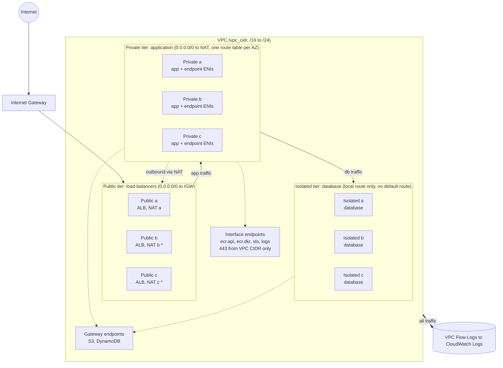

# Multi-AZ three-tier VPC (Terraform)

A Terraform module for a three-tier web application landing zone on AWS: public, private and isolated subnets across 2 or 3 availability zones, with NAT, VPC endpoints and flow logs wired in. It is plan-tested without AWS credentials. Nothing in this repository has been applied to an account.

## Problem statement

Teams that put a web application in AWS need a network that survives the loss of an availability zone, keeps databases unreachable from the internet, and does not leak traffic or money through NAT gateways. Hand-built VPCs drift: someone adds a default route to a database subnet, one AZ ends up without a NAT, or S3 traffic quietly pays NAT data charges. This module encodes the standard answer once, with subnet math derived from a single CIDR, per-environment cost defaults, private paths to AWS services, and flow logs on from day one. Dev and prod use the same code and differ only in inputs.

## Architecture



`*` NAT gateways b and c exist only with the `per_az` strategy (the prod default). With `single` (the dev and stage default) one shared NAT gateway sits in the first AZ and every private route table points at it.

The same picture for terminals, also saved as [docs/architecture.txt](docs/architecture.txt), for the default `10.0.0.0/16` and three AZs:

```text
                                   Internet
                                       |
                              +--------+--------+
                              | Internet Gateway|
                              +--------+--------+
                                       |
 VPC 10.0.0.0/16  (3 AZs shown)        |  public route table: 0.0.0.0/0 -> IGW
 ======================================|====================================
                                       |
   AZ a                        AZ b    |                 AZ c
 +----------------+      +----------------+      +----------------+
 | PUBLIC  /20    |      | PUBLIC  /20    |      | PUBLIC  /20    |
 | ALB nodes      |      | ALB nodes      |      | ALB nodes      |
 | [NAT GW a]     |      | [NAT GW b]     |      | [NAT GW c]     |  prod: 1 per AZ
 +-------+--------+      +-------+--------+      +-------+--------+  dev/stage: only
         | ^ HTTP(S) from ALB    |                       |            NAT GW a exists
         v |                     v                       v
 +----------------+      +----------------+      +----------------+
 | PRIVATE /20    |      | PRIVATE /20    |      | PRIVATE /20    |  one route table
 | app tier       |      | app tier       |      | app tier       |  per AZ:
 | [ENI: ecr.api, |      | [ENI: ecr.api, |      | [ENI: ecr.api, |  0.0.0.0/0 -> NAT
 |  ecr.dkr, sts, |      |  ecr.dkr, sts, |      |  ecr.dkr, sts, |  (own AZ in prod,
 |  logs]         |      |  logs]         |      |  logs]         |   shared in dev)
 +-------+--------+      +-------+--------+      +-------+--------+
         |  tcp 3306/5432        |                       |
         v                       v                       v
 +----------------+      +----------------+      +----------------+
 | ISOLATED /20   |      | ISOLATED /20   |      | ISOLATED /20   |  one route table:
 | database tier  |      | database tier  |      | database tier  |  local route only,
 |                |      |                |      |                |  NO default route
 +----------------+      +----------------+      +----------------+

 Data paths
 ----------
  1. User -> IGW -> ALB (public) -> app (private) -> database (isolated)
  2. App -> internet (patches, third-party APIs): private RT -> NAT GW -> IGW
  3. App -> S3 / DynamoDB: private RT -> gateway endpoint (prefix list), no NAT
  4. App -> ECR, STS, CloudWatch Logs: interface endpoint ENIs in the private
     subnets via private DNS, HTTPS 443 from the VPC CIDR only, no NAT
  5. Database -> S3 / DynamoDB only (backups, exports): isolated RT -> gateway
     endpoint. Nothing else leaves the isolated tier.
  6. All ENI traffic in the VPC -> VPC Flow Logs -> CloudWatch Logs
```

### Subnet layout

The VPC CIDR is split into 16 equal blocks with `cidrsubnet(vpc_cidr, 4, n)`. Each tier owns four consecutive slots, one per possible AZ, so growing from 2 to 3 AZs adds subnets without renumbering any existing one. Slots 12 to 15 are unused and reserved for a future tier.

| Tier | Slots | Example for 10.0.0.0/16 (AZ a, b, c) |
|---|---|---|
| public | 0, 1, 2 | 10.0.0.0/20, 10.0.16.0/20, 10.0.32.0/20 |
| private | 4, 5, 6 | 10.0.64.0/20, 10.0.80.0/20, 10.0.96.0/20 |
| isolated | 8, 9, 10 | 10.0.128.0/20, 10.0.144.0/20, 10.0.160.0/20 |

A /16 gives /20 subnets (4091 usable addresses each). A /24 gives /28 subnets (11 usable), the smallest AWS allows, which is why the accepted range stops at /24.

## Design decisions

| Decision | Alternative considered | Why |
|---|---|---|
| NAT per AZ in prod, one shared NAT in dev and stage (`nat_strategy = auto`) | Same NAT layout everywhere | A NAT gateway lives in one AZ. If that AZ fails, every AZ routed through it loses outbound access, and other AZs pay cross-AZ charges. Prod pays for resilience; dev does not need it. Can be overridden. |
| Gateway endpoints for S3 and DynamoDB | Send that traffic through NAT | Free, and removes NAT data charges for what is usually the largest traffic class. Also gives the isolated tier a private route to S3. |
| Interface endpoints for ecr.api, ecr.dkr, sts, logs | Reach them through NAT | Image pulls, role assumption and log shipping stay on the AWS network and keep working if a NAT fails. They cost money per AZ, so `enable_interface_endpoints` can switch them off. |
| Isolated subnets have no route out | Route databases through NAT | A database with no default route cannot reach or be reached from the internet, even with a bad security group. Managed databases patch through the service plane. The only exit is the S3/DynamoDB prefix-list route. |
| Private route table per AZ | One private table for all AZs | Each AZ needs its own next hop to use its own NAT. Public and isolated tables are the same in every AZ, so one each is enough. |
| Subnet slots fixed per tier and AZ index | Pack subnets back to back | Changing `az_count` never renumbers an existing subnet, which would force replacement of everything inside it. |
| AZs from `aws_availability_zones`, sorted, first N | Hardcoded AZ names | Works in any region, skips opt-in Local and Wavelength zones, and gives the same choice every run. Fails at plan time if the region has too few AZs. |
| Plan-only tests with a mocked provider | Real plans against an account | No credentials, no cost, runs in CI on forks. Provider-side validation is not exercised. |

Other choices, briefly:

- `modules/vpc` plus two example root configs, so environment wiring stays out of the module.
- Flow logs go to CloudWatch Logs (`ALL` traffic, 60 s windows) for immediate querying. S3 is a next step.
- The flow log role can write only to its own log group, and its trust policy is limited to this account's flow logs.
- The default security group is emptied and public subnets do not auto-assign public IPs.
- AWS provider `~> 6.0` and Terraform `>= 1.9, < 2.0`. The examples' lock files pin exact builds.
- Three Checkov findings are skipped inline with reasons: log retention under a year (a variable; prod uses 365), default log group encryption (KMS is a next step), and AZ pinning (only the first N sorted names are used).

## Prerequisites and usage

- Terraform 1.9 or newer (tested with 1.15.8)
- To plan or apply for real: AWS credentials with EC2, IAM and CloudWatch Logs permissions. Running the tests needs none.

```bash
cd examples/dev
cp terraform.tfvars.example terraform.tfvars   # edit region, CIDR, tags
terraform init
terraform plan
terraform output
```

`examples/prod` gives three AZs, one NAT per AZ and 365-day flow log retention. To use the module from your own configuration:

```hcl
module "vpc" {
  source = "github.com/zeinhaidara/01-terraform-multi-az-vpc//modules/vpc"

  region      = "us-east-1"
  environment = "prod"
  vpc_cidr    = "10.20.0.0/16"
  az_count    = 3
}
```

Run the CI checks locally from the repository root:

```bash
terraform fmt -check -recursive
terraform -chdir=modules/vpc init -backend=false
terraform -chdir=modules/vpc validate
terraform -chdir=modules/vpc test          # plan only, mocked provider
tflint --init && tflint --recursive
checkov -d . --framework terraform
```

### Inputs

| Name | Default | Notes |
|---|---|---|
| `region` | required | Used for endpoint service names |
| `environment` | required | `dev`, `stage` or `prod` |
| `project` | `three-tier` | Names and the `Project` tag |
| `vpc_cidr` | `10.0.0.0/16` | Prefix length /16 to /24 |
| `az_count` | `3` | 2 or 3 |
| `nat_strategy` | `auto` | `auto`, `per_az` or `single`. `auto` means `per_az` in prod and `single` otherwise |
| `enable_interface_endpoints` | `true` | Turn off to save the hourly endpoint cost |
| `flow_log_retention_days` | `30` | Any value CloudWatch Logs supports |
| `tags` | `{}` | Merged onto everything. `Environment`, `Project` and `ManagedBy=terraform` always win |

### Outputs

`vpc_id`, `vpc_cidr`, `availability_zones`, `public_subnet_ids`, `private_subnet_ids`, `isolated_subnet_ids` (each keyed by AZ), `subnet_cidrs`, `nat_gateway_ids` (keyed by AZ), `nat_strategy`, `route_table_ids`, `gateway_endpoint_ids` (keyed by `s3`, `dynamodb`), `interface_endpoint_ids` (keyed by service), `endpoint_security_group_id`, `flow_log_group_name`.

### Tests

`modules/vpc/tests` holds native `terraform test` files. They use `command = plan` against a mocked AWS provider and assert:

- subnet counts for 2 and 3 AZs
- no default route attached to the isolated route table
- NAT gateway count for `per_az`, `single`, and `auto` in dev, stage and prod
- all subnet CIDRs distinct, non-overlapping and inside the VPC, in a /16 and a /24
- subnet CIDRs unchanged when `az_count` changes
- endpoint set, private DNS, and the 443-from-VPC-CIDR rule
- rejected inputs: CIDR size, environment, AZ count, NAT strategy, retention, too few AZs

## Security considerations

**Private by construction.** Only the public tier routes to the internet gateway, and nothing there gets a public IP automatically. The private tier goes out only through NAT. The isolated tier has no default route. AWS service calls from private and isolated subnets stay on the AWS network through the endpoints, and the interface endpoint security group accepts only TCP 443 from the VPC CIDR. The default security group has no rules.

**What flow logs catch.** Accepted and rejected traffic (`ALL`) on every network interface in the VPC, in 60 second windows: source, destination, ports, protocol, bytes and the action taken. That supports spotting rejected probes, unexpected egress from the private tier, and any attempt to leave the isolated tier. Flow logs do not hold packet payloads or DNS query content, and they skip traffic to the Amazon DNS resolver, the instance metadata service and DHCP.

**Not covered.**

- Network ACLs stay at the VPC default (allow all). Security groups are the intended control.
- No AWS Network Firewall, WAF or egress filtering. A compromised app can reach any internet destination through the NAT.
- No security groups for the load balancer, app or database. Those belong with the workloads that use this VPC.
- Endpoint policies are the default full-access policy.
- Flow logs use default CloudWatch Logs encryption, not a customer managed KMS key.
- No DNS Firewall, no IPv6, no Transit Gateway or VPN attachment.

## Idempotency notes

- Re-running `plan` after `apply` should show no changes. AZ names are sorted and every resource is keyed by AZ name or service name, so ordering does not shift between runs. This holds by construction and in the plan-only tests; it has not been checked against a real apply.
- **AZ count 2 to 3** adds one subnet per tier, one private route table, and a NAT gateway with EIP when the strategy is `per_az`. Interface endpoints are modified in place to add the new private subnet. Existing subnets keep their CIDRs because slots are fixed.
- **AZ count 3 to 2** destroys the third AZ's subnets, route table and NAT. Move workloads out of that AZ first, or the destroy fails on subnets still in use.
- **`nat_strategy` single to per_az** creates the extra NAT gateways and repoints private routes in place. The reverse removes them, so outbound traffic changes path.
- **Changing `vpc_cidr`** replaces the VPC and everything in it. Treat it as fixed.
- The AZ list is the first N sorted names. If AWS adds a zone that sorts ahead of the ones in use, the module would pick it up and plan a change, so read plans after a region adds zones.

## Cost notes

Figures are us-east-1 list prices as I know them. Check current pricing before relying on them.

| Item | Approx. cost |
|---|---|
| NAT gateway, hourly | about $0.045 per hour each, roughly $33 per month |
| NAT gateway, data | about $0.045 per GB processed |
| Interface endpoint | about $0.01 per hour per endpoint per AZ, roughly $7 per month each, plus about $0.01 per GB |
| Gateway endpoints | free |
| Flow logs | CloudWatch Logs ingestion (about $0.50 per GB) and storage |

- **Why dev uses one NAT:** per-AZ NAT triples the hourly cost, and a dev environment can live with an AZ-level outbound outage. Prod accepts the cost for resilience and to avoid cross-AZ NAT traffic.
- **Interface endpoints are not free.** Four endpoints in three AZs is 12 network interfaces, roughly $88 per month before data. In a small dev environment that can cost more than the NAT, so `enable_interface_endpoints = false` is reasonable there. They pay off when image pulls, STS calls or log shipping run at volume through NAT.
- **Gateway endpoints** are the cheapest saving in the design: S3 and DynamoDB traffic skips NAT data charges.
- Destroying an environment when it is idle removes the biggest recurring items, NAT and endpoints.

## Known limitations and next steps

Limitations

- Tests are plan-only with a mocked provider, so provider-side API validation and real routing behaviour are not exercised.
- All subnets are the same size. A /16 gives equal /20s, which is generous for the public tier.
- One shared isolated route table, so per-AZ isolated routing needs a code change.
- AZs are the first N sorted names, with no way to choose specific zones.
- The interface endpoint list is fixed (ecr.api, ecr.dkr, sts, logs). Secrets Manager, SSM and others need a code change.
- The single shared NAT in dev and stage is a deliberate single point of failure for outbound traffic.
- Only the `aws` partition is considered. GovCloud and China are untested.

Next steps

- Customer managed KMS key for the flow log group.
- S3 flow log destination with a custom format and an Athena table.
- Security group and NACL baselines for the three tiers.
- Endpoint policies and a variable for extra interface endpoints.
- AWS Network Firewall or central egress through a Transit Gateway.
- Remote state and an apply pipeline with OIDC for the examples.
- Optional IPv6 and an egress-only internet gateway.

## Repository layout

```text
modules/vpc/            the module, with tests/ for terraform test
examples/dev/           2 AZs, shared NAT
examples/prod/          3 AZs, NAT per AZ
docs/architecture.txt   ASCII diagram
.github/workflows/      fmt, validate, tflint, test, checkov
```
